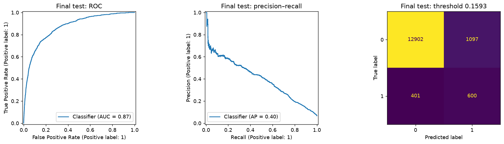
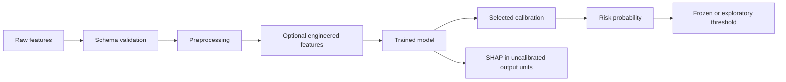

# CreditGuard

[](https://github.com/SanyaLikeIT/credit-guard/actions/workflows/ci.yml)

An end-to-end credit risk research project: data quality analysis, group-preserving holdouts,
baseline and tree models, probability calibration, conditional-cost thresholds, SHAP, and a local
Streamlit interface. It predicts serious delinquency within two years using historical financial
characteristics. It does not approve or reject loans.

## Results

Measured on the supplied **Give Me Some Credit** training file: 150,000 rows, 6.684% positive.
Each learned family below uses its engineered candidate. These are **uncalibrated model-selection
results** on 22,499 rows, at classification threshold 0.5:

| Model | ROC-AUC | Average Precision | Precision | Recall | F1 | Brier score |
| --- | ---: | ---: | ---: | ---: | ---: | ---: |
| Dummy prior | 0.50000 | 0.06707 | 0.00000 | 0.00000 | 0.00000 | 0.06257 |
| Logistic Regression | 0.85483 | 0.37871 | 0.21727 | 0.74354 | 0.33628 | 0.14602 |
| Random Forest | 0.85904 | 0.39436 | 0.60000 | 0.16302 | 0.25638 | 0.04966 |
| CatBoost | 0.86044 | 0.39949 | 0.21418 | 0.77071 | 0.33521 | 0.14230 |

CatBoost was selected by the highest selection Average Precision; Brier score breaks ties.
Its class-weighted raw probabilities are poorly calibrated. On the **internal calibration
validation** split, sigmoid calibration reduced Brier score from **0.13822 to 0.04851**;
isotonic scored 0.04858. The selected calibrator was refitted on the full calibration partition.
These calibration comparison scores are not final test scores.

After freezing the pipeline, calibration, and threshold, the **15,000-row final test** gave:

| Metric | Final result | Approximate 95% bootstrap interval |
| --- | ---: | ---: |
| ROC-AUC | 0.86820 | 0.85513–0.87803 |
| Average Precision | 0.40223 | 0.37354–0.43017 |
| Brier score | 0.04872 | 0.04749–0.05027 |
| Precision / recall / F1 | 0.35357 / 0.59940 / 0.44477 | — |
| Accuracy / balanced accuracy | 0.90013 / 0.76052 | — |
| Log loss | 0.17609 | — |

The frozen threshold is **0.15931719072828796**, using `probability >= threshold` and hypothetical
`C_FP:C_FN = 1:5`. Final confusion matrix `[[TN, FP], [FN, TP]]` is
`[[12902, 1097], [401, 600]]`; conditional cost is 3,102, or 0.2068 per record.
Intervals use 300 stratified row resamples, conditional on the fitted model and split. They exclude
selection uncertainty and do not fully account for within-group dependence.
Average Precision is sklearn's step-wise AP, not trapezoidal PR area.



## Dataset and access

Source: [Give Me Some Credit on Kaggle](https://www.kaggle.com/c/GiveMeSomeCredit/data).
The license is **subject to the [competition rules](https://www.kaggle.com/competitions/GiveMeSomeCredit/rules)**;
this repository does not redistribute source data or grant rights to it.

1. Sign in to Kaggle and review/accept the applicable competition terms when prompted.
2. Download the competition archive.
3. Put `cs-training.csv`, `cs-test.csv`, `Data Dictionary.xls`, and `sampleEntry.csv` in `data/raw/`.

If the Kaggle CLI is already authenticated and your account has accepted the terms:

```text
kaggle competitions download -c GiveMeSomeCredit -p data/raw
```

Extract the archive into `data/raw/`. Kaggle is not a project dependency; manual download works
as well. Never commit credentials or source records.

The checked files contain 150,000 labeled training rows and 101,503 unlabeled competition test rows.
`SeriousDlqin2yrs = 1` means 90-day delinquency or worse within two years, following the competition
definition. The ten raw inputs cover utilization, age, debt ratio, income, credit lines, real-estate
credit, three delinquency counts, and dependents. The empty-name CSV index is excluded.
The original competition test is used for inference only, never for fabricated evaluation metrics.
Ratios use their original scale: utilization `0.25` represents 25%; values above 1 are supported.
The supplied dictionary does not specify a currency for income.

## Methodology



**Splitting and leakage prevention.** Seed 42; approximate 60/15/10/5/10 proportions:

| Partition | Rows | Purpose |
| --- | ---: | --- |
| Training | 89,975 | Fit transformations, training-only CV and early stopping |
| Model selection | 22,499 | Model and feature-engineering comparisons |
| Calibration | 15,018 | Internal method selection, then calibrator refitting |
| Threshold | 7,508 | Cost/F1 thresholds and cost sensitivity |
| Final test | 15,000 | Independent evaluation after freezing decisions |

There are 646 repeated feature vectors and 37 groups with conflicting labels. Feature groups are
hashed without the target or technical index. All conflicting observations are retained within
one partition. Groups are stratified by majority label, so row proportions are approximate.
Groups also remain intact in CV, internal CatBoost early stopping, and calibration validation.
Local row-position/hash assignments are saved privately; overlap checks cover every partition.

**Training EDA.** Income is missing in 17,945 training rows (19.94%), dependents in 2,319 (2.58%).
There are 1,994 utilization values above 1. Codes 96/98 co-occur in all three delinquency counters
for 147 training records. The dictionary does not define these codes: treating them as unresolved
values is a modeling assumption. There are no age-zero training records; the pipeline handles
age zero as unknown. Debt ratio, income, and utilization have long tails. No source rows are
deleted merely for being extreme.

**Preprocessing.** All fitted statistics belong to training data, including individual CV training
folds. Logistic Regression uses training-only 99.5th-percentile clipping of income, debt ratio,
and utilization; median imputation; missing indicators; and standardization. Random Forest uses
imputation without scaling or clipping. CatBoost handles numeric missing values natively, without
scaling or clipping. Training and inference share one sklearn pipeline.

**Models and search.** Dummy prior, regularized Logistic Regression, Random Forest, and CatBoost.
Full mode samples three configurations per learned model, each evaluated in three stratified,
group-aware CV folds. AP is the optimization metric; ROC-AUC and negative Brier score are also
recorded. Searches compare class weights and bounded estimator parameters. CatBoost CV uses
600 iterations; training-only early stopping chooses 254 for refitting. The selected model uses
depth 8, learning rate 0.03, L2 regularization 8, and balanced class weights. CPU execution is
limited to four threads by default. This is a small controlled search, not exhaustive optimization.
Training versus selection AP and CV dispersion provide descriptive overfitting checks.

**Feature engineering.** Delinquency totals, severity weights, and indicators; log transforms;
household income; real-estate share; and missing/special-code indicators. Severity weights are
modeling choices, not financial losses. Missing denominators stay unknown; zero loans with zero
real estate gives a zero share. Raw and engineered candidates share estimator parameters,
including the CatBoost iteration count selected using the raw training-only early-stopping probe.

| Family | Raw AP | Engineered AP | Difference on selection set |
| --- | ---: | ---: | ---: |
| Logistic Regression | 0.37617 | 0.37871 | +0.00254 |
| Random Forest | 0.39200 | 0.39436 | +0.00235 |
| CatBoost | 0.39488 | 0.39949 | +0.00461 |

**Calibration and thresholds.** Uncalibrated, sigmoid-on-logit, and isotonic methods are compared
on an internal 50% calibration validation holdout. Minimum Brier score wins, then log loss.
Only the winning method is refitted on the full calibration set. Threshold optimization uses the
same calibrated probabilities on a separate holdout. Exact thresholds include every observed
score and an all-negative boundary; ties prefer the highest threshold. At C_FP:C_FN 1:5, holdout
costs are 2,069 at 0.5, 1,570 at F1-optimal 0.165056, and 1,568 at cost-optimal 0.159317.
Sensitivity covers 1:1, 1:2, 1:5, 1:10, and 1:20. These are hypothetical conditional costs, not
validated bank savings. Matched-parameter class-weight comparisons show why better recall alone
need not mean better calibration or cost.

**Explainability and errors.** SHAP uses a fixed 400-row selection sample, with additivity checked.
Utilization, its log transform, delinquency summaries, and age dominate mean absolute contributions.
CatBoost SHAP is in **uncalibrated log-odds**, not calibrated probability points or causal effects.
Correlated source and engineered features can share attribution. Global plots export no raw
customer feature values. Individual explanations use user-entered or synthetic records locally.

Final diagnostics found 1,097 false positives, 401 false negatives, 334 records within 0.02 of the
threshold, and 82 high-confidence errors: negative at probability >=0.8 or positive at <=0.02.
Recall varies across descriptive age groups: about 0.48 above 60 versus 0.69 at 30 or younger,
with different base rates and sizes. Removing age reduced selection AP from 0.39949 to 0.39656
at matched parameters. Neither result establishes fairness. No modeling changes follow test diagnostics.

## Installation and use

Python **3.11–3.14**, Linux, and CPU are supported. From the project root in Fish:

```fish
python -m venv .venv
source .venv/bin/activate.fish
python -m pip install -e '.[dev]'
```

Use a local environment, without sudo or global package installation. `pyproject.toml` is the
dependency source. `requirements-lock.txt` is a generated snapshot of the validated Python 3.14
environment. On Python 3.14, install it before the editable package when reproducing that environment:
`python -m pip install -r requirements-lock.txt`. Other supported versions resolve compatible
versions from `pyproject.toml`. Seeds, configuration, library versions, dataset checksum, split
sizes, parameters, and schema are recorded. Bit-for-bit reproducibility across environments is not promised.

After placing the source files in `data/raw/`, reproduce the full experiment and run the app:

```fish
python -m creditguard.train --profile full
python -m creditguard.evaluate
streamlit run app/main.py
```

The supplied local checkout already has weights in `models/final/`; inference and Streamlit work
without training again. Weights are ignored by Git, so a fresh clone requires the training command
above. Published aggregate reports do not block reproduction when weights are absent. Training
refuses to overwrite an existing trained run with a final evaluation. For a deliberately separate
experiment use `--output-dir outputs/my-run`. Never use the same final test for iterative model
decisions. Evaluation verifies model/report checksums and reads the frozen result; it does not retrain.

Quick mode uses the real dataset with reduced budgets and isolated output directories:

```fish
python -m creditguard.train --profile quick
python -m creditguard.predict --model-dir outputs/quick/models --demo intermediate
```

Quick is a smoke profile, not the published full experiment. Budgets, paths, split proportions,
costs, and seeds live in `configs/default.yaml`; `--config` supports an alternative YAML file.

Single inference from a JSON object of the ten raw features, a synthetic example, and batch inference:

```fish
python -m creditguard.predict --json applicant.json
python -m creditguard.predict --demo intermediate
python -m creditguard.predict --csv data/raw/cs-test.csv --output predictions.csv
```

Batch accepts raw features or the original unlabeled competition CSV, dropping the technical index
and empty target. Validation rejects unexpected columns, nonnumeric/negative/infinite values,
fractional counts, and missing required inputs. Income/dependents can be missing. Output contains
probability, threshold, above/below-threshold classification, model, and calibration status.
Load **only trusted local model artifacts**: joblib can execute code. Checksums detect corruption,
not malicious authorship. Do not upload arbitrary downloaded artifacts.

Streamlit provides **Risk Assessment**, **Model Performance**, and **About**. It caches the saved
model and reads saved reports without training. A threshold slider changes classification without
changing probability. Synthetic profiles score about 0.67%, 13.73%, and 71.08% under the saved model.
Missing artifacts produce a training instruction. Inputs are not saved, logged as financial records,
or sent to external services. For a different trusted run directory, Fish supports:

```fish
env CREDITGUARD_MODEL_DIR=outputs/my-run/models CREDITGUARD_REPORT_DIR=outputs/my-run/reports streamlit run app/main.py
```

## Validation and notebooks

```fish
pytest
ruff check .
ruff format --check .
python -m pip check
python scripts/check_notebooks.py
```

Tests use small synthetic fixtures without Kaggle credentials or the source dataset. They cover
schemas, duplicate groups, fold-safe preprocessing, exact feature values, threshold/cost math,
calibration, serialization, CLI subprocesses, SHAP names and additivity, all three Streamlit pages,
and a small end-to-end training integration test. The four notebooks read saved aggregate reports;
the last also demonstrates saved-model inference. Each is executed in a fresh kernel using the
active environment, without hidden manual cell-order dependencies.

Local validation completed with **45 passed, 0 failed**, all four notebooks executed, Ruff lint
and formatting checks passed, and `pip check` reported no dependency conflicts. Batch inference
also produced and validated all 101,503 competition-test predictions, without computing metrics
on the unlabeled file.

The server and health endpoint were checked over HTTP. `AppTest` exercised all three pages with
real artifacts, prediction, and threshold changes. Browser automation was unavailable, so no browser
screenshot or browser-layout verification is claimed. SHAP emits three upstream Matplotlib
pending-deprecation warnings; they do not fail validation. GitHub Actions checks installation,
dependency consistency, Ruff, and unit/integration tests on Python 3.11 and 3.14, without data,
GPU, or user credentials.

## Structure and artifacts

```text
app/                    Streamlit entry point and three page wrappers
configs/default.yaml    Seed, splits, model budgets, paths, and costs
data/raw/               Local competition files (ignored)
notebooks/              01_eda, 02_baselines, 03_model_comparison, 04_model_analysis
src/creditguard/        Validation, features, modeling, calibration, thresholds,
                        explanations, inference, reporting, CLI, and UI
tests/                  Unit, integration, CLI, and Streamlit checks
scripts/                Fresh-kernel notebook execution
models/final/           pipeline.joblib and metadata.json (local, ignored)
reports/metrics/        Model/CV, calibration, cost/threshold, final, SHAP,
                        subgroup/error reports, and frozen metadata
reports/figures/        Aggregate EDA and evaluation plots
reports/private/        Local split hashes and holdout predictions (ignored)
.github/workflows/      CI
```

Raw data, archives, model weights, environments, caches, and private row-level artifacts are ignored.
Aggregate tables, figures, and executed notebooks document the real experiment. The dataset
fingerprint is recorded in `reports/metrics/split_summary.json`.

## Limitations

Historical competition data is not an external or temporal validation of current lending. There
are no timestamps for temporal splitting, limited protected attributes, unresolved sentinel-code
semantics, no economic validation of costs, and only a small search. Repeated selection comparisons
add uncertainty. Calibration and subgroup behavior may shift across populations. Removing age
alone cannot remove bias. The data is insufficient for a comprehensive fairness audit.

This project is intended for educational and research purposes. It is not a production credit
decision system or financial advice.
